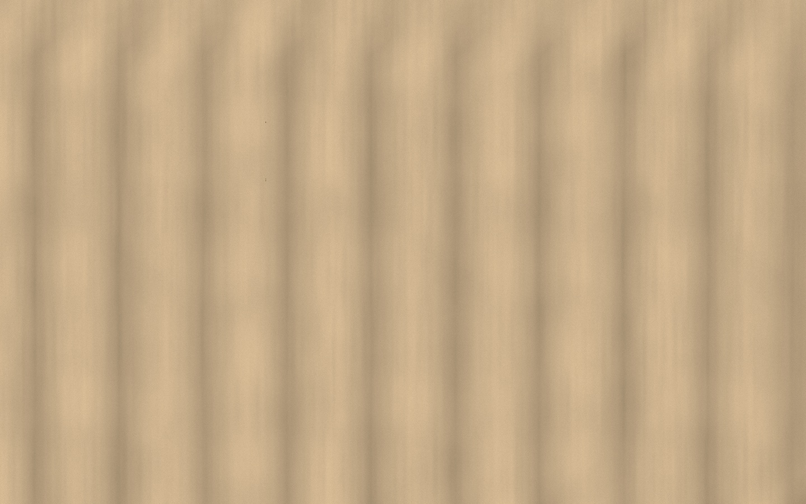
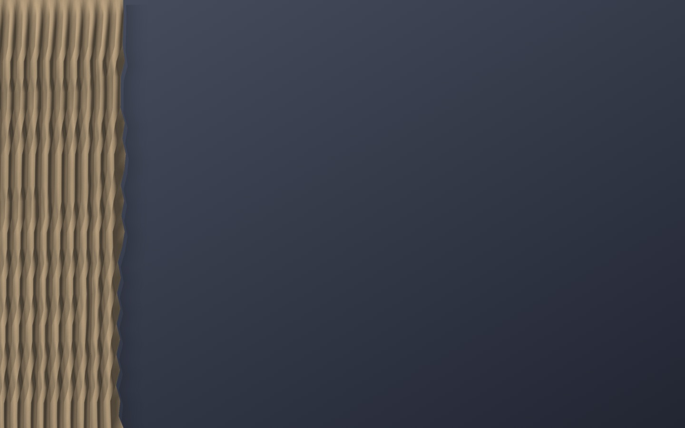

# Curtain

A macOS menu bar app that hangs a cloth curtain over your desktop. Pull it
shut before you share your screen and your desktop icons, wallpaper and
widgets are hidden behind heavy fabric; pull it open afterwards. The cloth is
simulated with real physics, so it sways, folds and bunches up like fabric,
and it idles at zero CPU when still.

  
  

- Sits above the desktop and below every app window, on every Space.
- Drag the leading edge, or grab the fabric anywhere and tug it.
- Menu bar item and a global shortcut (control + option + command + C).
- Three fabrics: beige, matte black, velvet red. All generated in code.
- Sounds (synthesized, no audio files) and trackpad haptics. Mutable.
- No Dock icon, no settings window, no permissions requested.

## Requirements

- macOS 14 or later on Apple silicon. (It should build on an Intel Mac too,
  but it has only been run on Apple silicon.)
- The Command Line Tools. Xcode itself is not needed. If `swift --version`
  prints nothing useful, run:

      xcode-select --install

## Install

    git clone https://github.com/tarunfy/curtain.git
    cd curtain
    make install

That builds the app, copies it to /Applications and launches it. The first
build takes a minute; later ones a few seconds. Curtain appears as a curtains
icon in the menu bar. To have it start at login, add /Applications/Curtain.app
under System Settings → General → Login Items.

Other commands:

    make run     # build and launch from the build folder, without installing
    make stop    # quit it
    make test    # run the unit tests
    make clean   # delete build output

The app is signed ad hoc by the build, which is enough to run on the Mac
that built it. A copy sent to another Mac (AirDrop, download) arrives
quarantined and macOS will warn that it cannot verify the developer; building
from source on that Mac avoids this, as does a paid Developer ID signature.

## Use

Hover near the curtain's right edge until the cursor becomes a hand, then
drag. Let go and it stays; fling it and it carries on to the end of the rail.
Click anywhere else on the fabric to tug it. The menu item or the shortcut
slides it the rest of the way. The menu also picks the fabric and mutes the
sounds.

Every number that changes how the curtain looks and feels, including the
shortcut, lives in `Sources/CurtainCore/Tuning.swift`, each with a comment
on what it does. Edit, `make run`, judge.

## How it works

The curtain is a grid of particles joined by distance constraints, stepped
with Verlet integration at a fixed 120 Hz with an accumulator, several
relaxation passes per step. The top row are rings on a rail that slide only
when the chain of fabric between them pulls or pushes; the leading ring is
driven by your hand through a spring, which is the weight you feel. Columns
remember a pleat shape so bunching produces even folds. Rendering is Metal:
a lit, textured mesh with per-vertex normals, a velvet sheen, a fold shadow,
and a procedurally generated fabric texture.

The overlay is a transparent, borderless, non-activating panel one level
below normal windows. It is click-through except where fabric hangs, which
a system-wide mouse watcher decides without any permission.

## Layout

    Makefile                             build, run, install, test
    Package.swift                        the Swift package (like package.json)
    Sources/CurtainCore/Tuning.swift     every tunable number, with comments
    Sources/CurtainCore/Cloth.swift      the simulation (pure Swift, no AppKit)
    Sources/CurtainCore/ClothMesh.swift  normals, texture coordinates, fold shadow
    Sources/Curtain/main.swift           entry point
    Sources/Curtain/AppDelegate.swift    menu bar item, shortcut, mouse watcher
    Sources/Curtain/OverlayWindow.swift  the transparent full-screen window
    Sources/Curtain/CurtainView.swift    Metal view, input, frames, launch drop
    Sources/Curtain/Renderer.swift       Metal pipelines and drawing
    Sources/Curtain/Shaders.metal        vertex and fragment shaders
    Sources/Curtain/FabricTexture.swift  procedural fabric texture
    Sources/Curtain/SoundEngine.swift    swish, rattle and thump, synthesized
    Sources/Curtain/HotKey.swift         the global keyboard shortcut (Carbon)
    Sources/Curtain/Diagnostics.swift    debug logging, wireframe and snapshot switches
    Sources/Curtain/Info.plist           bundle metadata (no Dock icon)
    Tests/CurtainCoreTests/              headless checks on the simulation

Environment switches for poking at it (set when launching the binary
directly, `build/Curtain.app/Contents/MacOS/Curtain`):

    CURTAIN_DEBUG=1              log mouse and sleep/wake decisions
    CURTAIN_WIREFRAME=1          draw the mesh as lines
    CURTAIN_LOOK=black|beige|red try a fabric without editing Tuning.look
    CURTAIN_START=closed         start with the curtain drawn across the screen
    CURTAIN_SNAPSHOT=/path.png   save one frame as PNG when the cloth settles
    CURTAIN_SNAPSHOT_AFTER=8     ...or after this many seconds regardless

Shaders are compiled at launch from `Shaders.metal` inside the app, so no
Metal compiler is needed to build. The test target runs Swift Testing; the
Makefile passes the search paths the Command Line Tools need for it.

## License

MIT. See [LICENSE](LICENSE).
